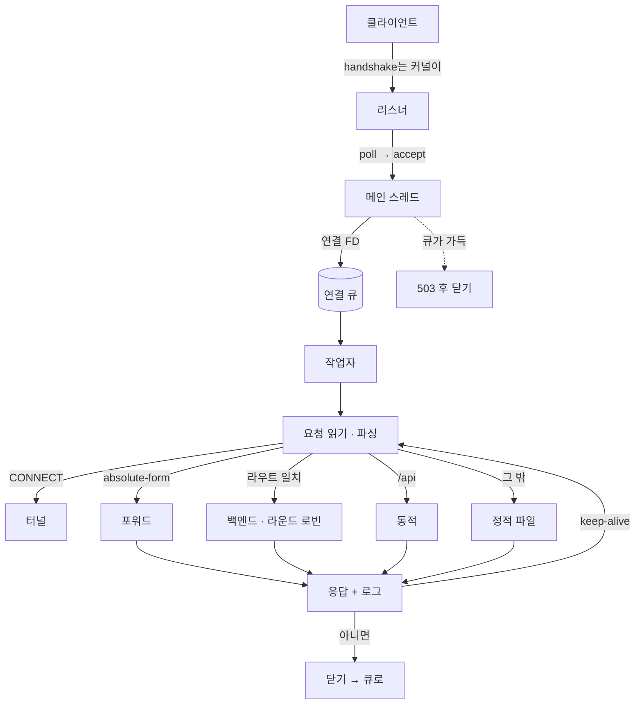

# Week 13 · Mini Webserver

> [!NOTE]
> 외부 라이브러리 없이 **POSIX 소켓만으로** 만든 C11 웹 서버.
> 실행 파일 하나가 **정적 파일 · API · Reverse Proxy · Forward Proxy** 가 된다.

| 기능 | 한 줄 |
|---|---|
| 정적 파일 | GET · HEAD, `index.html`, MIME, 경로 탈출 거부 |
| 동적 API | `/api/whoami` · `/api/echo` |
| Reverse Proxy | 경로 라우트 + 라운드 로빈 |
| Forward Proxy | absolute-form 전달 + CONNECT 터널 |
| 연결 | HTTP/1.0 · 1.1, keep-alive, 파이프라이닝 |
| 운영 | 스레드 풀, 안전 종료, 접근 로그 |

**목차**
[1. 빠른 시작](#1-빠른-시작) ·
[2. 요청 흐름](#2-요청-흐름) ·
[3. 중점 포인트](#3-중점-포인트) ·
[4. 범위와 한도](#4-범위와-한도) ·
[5. 테스트](#5-테스트) ·
[6. 측정 결과](#6-측정-결과) ·
[7. 문서](#7-문서)

---

## 1. 빠른 시작

### ① 준비 · 빌드 · 테스트

Windows 는 PowerShell(관리자)에서 `wsl --install -d Ubuntu-24.04` 한 번. 그다음 Ubuntu 에서:

```sh
sudo apt-get update && sudo apt-get install -y build-essential python3 curl clang-format-18
git clone https://github.com/kuk-hwan/WEEK13-Kkilkkilson.git && cd WEEK13-Kkilkkilson
git config core.hooksPath .githooks
make && make test
```

### ② 실행 — 서버 하나, 또는 프록시 + 백엔드 A · B

```sh
# 서버 하나
./build/mini-webserver --port 8080

# 프록시 + A · B (터미널 3개)
./build/mini-webserver --port 9001 --name A
./build/mini-webserver --port 9002 --name B
./build/mini-webserver --port 9000 --route '/api=127.0.0.1:9001,127.0.0.1:9002'

curl http://127.0.0.1:9000/api/whoami   # A, 한 번 더 하면 B
```

- 브라우저 `http://127.0.0.1:9000/` → 데모 페이지. 끄기는 Ctrl-C (종료 코드 0)
- 이 구성 전체를 curl 로 한 번에 : `make smoke`

<details>
<summary><b>curl 예시 · 접근 로그 · macOS · 선택 도구</b> (펼치기)</summary>

```sh
curl -i http://127.0.0.1:8080/                          # 200 데모 페이지
curl -i http://127.0.0.1:8080/api/whoami                # {"name":"server-8080","port":8080}
curl -i --data 'hello' http://127.0.0.1:8080/api/echo   # 본문 그대로
curl -i http://127.0.0.1:8080/missing.html              # 404
```

요청마다 표준 오류에 한 줄 : 시각 · 클라이언트 · 메서드 · 경로 · 상태 · 보낸 바이트 · 처리 시간

```text
2026-11-25T02:13:09Z 127.0.0.1 GET /api/whoami 200 163 0ms
```

- macOS : Xcode Command Line Tools, Python 3, clang-format
- 선택 : `apache2-utils`(부하 측정), `valgrind`(메모리 검사)

</details>

<details>
<summary><b>포워드 프록시로 쓰기</b> (펼치기)</summary>

```sh
./build/mini-webserver --port 8080 --forward-allow 127.0.0.1/32
curl -x http://127.0.0.1:8080 http://127.0.0.1:9001/api/whoami      # 전달
curl -x http://127.0.0.1:8080 https://example.com/                   # CONNECT 터널
curl -p -x http://127.0.0.1:8080 http://127.0.0.1:9001/api/whoami   # TLS 없이 CONNECT
```

- `--forward-allow` 가 하나라도 있어야 켜진다. 목록 밖은 **403**
- `https://` 는 CONNECT 터널. 바이트를 해석하지 않고 양쪽으로 넘긴다
- 터널 하나 = 작업자 하나. 브라우저 프록시로 쓰면 `--workers 64` 처럼 늘린다
- 목적지 DNS(`getaddrinfo`)는 블로킹. 3초 deadline 밖이다

</details>

<details>
<summary><b>옵션과 종료 코드</b> (펼치기)</summary>

| 인자 | 기본값 | 범위 |
|---|---|---|
| `--host` | `127.0.0.1` | IPv4 |
| `--port` | `8080` | 1~65535 |
| `--root` | `public` | 있는 디렉터리 |
| `--workers` | `8` | 1~128 |
| `--queue` | `64` | 1~4096 |
| `--name` | `server-<포트>` | 63바이트 |
| `--route` | 없음 | `'/접두사=호스트:포트[,...]'` 16개 × 백엔드 8개 |
| `--forward-allow` | 없음 (꺼짐) | CIDR 16개 |

| 종료 코드 | 뜻 |
|---|---|
| 0 | 정상 종료 |
| 1 | 실행 오류 (포트 충돌 등) |
| 2 | 인자 오류 |

</details>

---

## 2. 요청 흐름

> [!NOTE]
> 연결은 **큐**를 거쳐 **작업자 하나**가 끝까지 맡는다.



| 모듈 | 파일 | 하는 일 |
|---|---|---|
| main | `src/main.c` | 인자 → 실행 → 종료 코드 |
| config | `src/config.c` | 옵션 검증, 루트 FD, 라우트 |
| net | `src/net.c` | listen · connect, deadline 읽기 · 쓰기 |
| pool | `src/pool.c` | 작업자 N개 + 크기 제한 큐 |
| http | `src/http.c` | 요청 파싱 · 한도, 응답 헤더 |
| app | `src/server.c` | accept 루프, keep-alive, 분기, 로그, 종료 |
| static | `src/static.c` | 경로 검사, 8 KiB씩 전송 |
| proxy | `src/proxy.c` | 라우트, 라운드 로빈, 포워드, 터널 |

<details>
<summary><b>FD 수명</b> (펼치기)</summary>

| FD | 용도 | 언제 닫나 |
|---|---|---|
| 루트 디렉터리 | 파일 열기 기준 | 서버 끝날 때 |
| 리스너 | 새 연결 받기 | accept 루프 끝 |
| self-pipe | 시그널로 루프 깨우기 | 서버 끝날 때 |
| 클라이언트 | 요청 · 응답 | 연결 처리가 끝나면 |
| 백엔드 · 목적지 | 프록시 · 터널 | 요청(터널) 하나 끝나면 |
| 정적 파일 | 파일 읽기 | 전송 뒤 |

</details>

---

## 3. 중점 포인트

> 항목마다 같은 순서 : **한 줄 답 → 어떻게 → 코드 → 확인**

### 3-1. handshake · `SO_REUSEADDR` · blocking

> [!NOTE]
> handshake 는 **커널**이, non-blocking 은 **시간 제한**을 위해.

- **handshake**
	- SYN → SYN-ACK → ACK 는 커널이 끝낸다
	- `accept` 는 완성된 연결을 대기열(`SOMAXCONN`)에서 꺼낼 뿐
- **`SO_REUSEADDR`**
	- 끈 직후 포트가 TIME_WAIT 로 남는다
	- 이 옵션으로 바로 재시작 → `socket → SO_REUSEADDR → bind → listen`
- **blocking / non-blocking**
	- 리스너 : non-blocking + self-pipe 와 함께 `poll` (종료 신호에 바로 깸)
	- 연결 소켓 : non-blocking + `poll` 로 **절대 deadline** 까지 기다림
	- 작업자에게는 동기식 코드. 하지만 느린 상대 때문에 영원히 멈추지 않는다
	- 백엔드 연결 : non-blocking `connect`(`EINPROGRESS`), 3초

코드 `src/net.c`, `src/server.c` `accept_loop`
확인 같은 포트 즉시 재시작 · 포트 충돌 종료 코드 1 · deadline 단위 테스트

### 3-2. 요청 경계와 `Content-Length`

> [!NOTE]
> TCP 는 경계가 없다 → **빈 줄**과 **`Content-Length`** 로 자른다.

- 요청이 쪼개져 오거나, 두 개가 붙어 올 수 있다
- 머리 = 빈 줄(`\r\n\r\n`)까지
- 본문 = `Content-Length` 바이트만큼
- 남은 바이트 = 다음 요청 (파이프라이닝)

| 경우 | 응답 |
|---|---|
| 숫자 아님 · 다른 값 중복 | 400 |
| POST 에 없음 | 411 |
| 1 MiB 초과 | 413 (본문 읽기 전) |
| chunked 요청 본문 | 501 |

- 파싱 오류 뒤에는 경계를 못 믿으니 **연결을 닫는다**

코드 `src/http.c` `mw_http_read_request`
확인 나뉘어 온 머리 · 한 바이트씩 · 파이프라이닝 · 400 · 411 · 413 · 501

### 3-3. keep-alive

> [!NOTE]
> 연결을 다시 쓰되, **시간 · 횟수 상한**을 둔다.

| 항목 | 값 | 넘으면 |
|---|---|---|
| 유지 조건 | 1.1 기본 · 1.0 은 요청할 때만 | `Connection: close` |
| 유휴 | 5초 | 조용히 닫기 |
| 요청 deadline | 첫 바이트부터 5초 (안 늘어남) | 408 후 닫기 |
| 연결당 요청 | 100 | 100번째에 close |
| 서버 종료 중 | — | 유휴 연결 바로 닫기 |

코드 `src/server.c` `handle_connection` · `wait_for_next_request`
확인 1.1 · 1.0 · 파이프라이닝 · 100번째 · 느린 머리 · 유휴 종료 · 종료 중 닫기

### 3-4. 동시성 트레이드오프와 C10K

> [!NOTE]
> **스레드 풀 + 크기 제한 큐**. 대가는 쉬는 연결도 작업자를 붙잡는 것.

**우리 모델**
- 메인 스레드 : `accept` → 연결 FD 를 큐에
- 작업자 N개 : FD 를 꺼내 **연결이 끝날 때까지** 맡음
- 큐가 가득 → 503
- mutex 는 큐만. I/O 중엔 잠금 없음

**세 모델 비교**

| 모델 | 얻는 것 | 내주는 것 |
|---|---|---|
| 연결마다 스레드 | 가장 단순 | 스레드가 무한히 늘어남 |
| **스레드 풀 (선택)** | 스레드 상한, 동기식 코드, 여러 코어 | 쉬는 연결 · 터널이 작업자를 잡음 |
| 이벤트 루프 | 스레드 하나로 연결 수천 | 상태 기계 필요, 블로킹 하나가 전체를 멈춤 |

**이벤트 루프를 안 고른 이유**
1. 블로킹 작업이 있다 — DNS(`getaddrinfo`), 디스크 파일(`poll` 불가)
2. 명세가 C10K 를 목표로 하지 않는다
3. WSL2 · macOS 둘 다 → `epoll` · `kqueue` 를 못 씀
4. 동기식 코드가 리뷰 · 테스트로 검증하기 쉽다

**C10K — 1만 연결이 오면 어디서 막히나**

| 순서 | 자원 | 한도 | 넘으면 |
|---|---|---|---|
| 1 | 작업자 | 최대 128 | 큐에서 대기 |
| 2 | 연결 큐 | 최대 4096 | 503 |
| 3 | `listen` 대기열 | `SOMAXCONN` | 커널이 늦추거나 버림 |
| 4 | FD 수 | `ulimit -n` | `EMFILE` → 10 ms 쉬고 재시도 |
| 5 | 스레드 메모리 | 스택 8 MiB (가상) | 작업자 1만 개는 불가 |

- 결론 : **작업자에서 먼저** 막히고, 작업자를 늘리는 길은 메모리가 막는다
- 다음 단계 (구현 안 함) : 쉬는 연결을 작업자에게서 떼어 내기 → `epoll` · `kqueue` → 상태 기계 파서 → 비동기 DNS
- 측정으로 본 대가 → [6. 측정 결과](#6-측정-결과)

코드 `src/pool.c`, `src/server.c` `accept_loop` · `reject_overloaded`
확인 동시 50명 모두 200 · 큐 초과 503 · `make bench`

### 3-5. Proxy 와 Reverse Proxy

> [!NOTE]
> Reverse 는 **서버 편**, Forward 는 **클라이언트 편**.

| | Reverse | Forward |
|---|---|---|
| 누구 편 | 서버 (백엔드를 숨김) | 클라이언트 (목적지를 고름) |
| 요청 대상 | `GET /api/whoami` | `GET http://host/path`, `CONNECT host:port` |
| 목적지 | 가장 긴 접두사 + 라운드 로빈 | 요청 URI |
| 켜기 | `--route` | `--forward-allow` |
| 함수 | `mw_proxy_serve` | `mw_proxy_forward` · `mw_proxy_tunnel` |

- 공통 : hop-by-hop 헤더 제거, `X-Forwarded-For` 덮어쓰기
- 백엔드 응답 : 8 MiB 까지, chunked 는 풀어서
- 실패 : 연결 실패 · 깨진 응답 502, 3초 초과 504, **재시도 없음**
- CONNECT : TLS 를 풀지 않고 두 소켓을 `poll` 하며 바이트만 넘김
- 허용 목록이 없으면 안 켜짐 → "열린 프록시" 불가 ([ADR-0001](docs/adr/0001-forward-proxy.md))

확인 라우트 · 라운드 로빈 단위 테스트, 프록시 · 라우팅 · 포워드 · 터널 통합 테스트, `make smoke`

### 3-6. 메모리 관리

> [!NOTE]
> 연결마다 버퍼 **하나**, 파일은 **조각으로**, 모든 경로에서 **회수**.

- 읽기 버퍼 : 연결마다 하나, 16 KiB 로 시작 → 필요하면 1 MiB 까지
- 파일 : 통째로 안 올림, 8 KiB 씩
- 프록시 버퍼 : 요청마다 해제, 8 MiB 넘으면 502
- `malloc` · `free` 는 같은 모듈 안에서 짝
- FD 를 누가 닫는지 : [`docs/CONTRACT.md`](docs/CONTRACT.md)

확인 `make sanitize-test` (ASan · UBSan) · `make valgrind` (힙 · 오류 · 남은 FD)

### 3-7. 시그널과 종료

> [!NOTE]
> 핸들러는 **플래그 + 1바이트**만. 나머지는 메인 루프가.

- 핸들러 : 플래그 세우고 self-pipe 에 1바이트 (async-signal-safe)
- 작업자 : SIGINT · SIGTERM 을 막음 → 메인만 받음
- `SIGPIPE` : 무시, 쓰기 실패는 반환값으로

**종료 순서**
1. 리스너 닫기
2. 큐의 대기 연결 닫기
3. 처리 중 요청은 마무리, 유휴 연결 · 터널은 바로 닫기
4. 작업자 join
5. 메모리 해제 → 종료 코드 0

코드 `src/server.c` `on_stop_signal` · `mw_server_run`, `src/pool.c`
확인 종료 통합 테스트 · `make valgrind` 의 SIGINT 종료 검사

---

## 4. 범위와 한도

| 항목 | 한도 | 넘으면 |
|---|---|---|
| 메서드 | GET · HEAD · POST (+ 포워드 켜면 CONNECT) | 501 |
| 버전 | 1.0 · 1.1 | 505 |
| 요청 줄 | 8 KiB | 414 |
| 머리 | 16 KiB, 64개 | 431 |
| 본문 | 1 MiB | 413 |
| `Host` | 1.1 에서 필수 | 400 |
| `Expect` | `100-continue` 만 | 417 |
| 요청 시간 | 5초 | 408 |
| 백엔드 시간 | 3초 | 504 |
| 유휴 · 터널 유휴 | 5초 | 닫기 |

- 오류 응답(400 · 408 · 411 · 413 · 414 · 417 · 431 · 501 · 505) 뒤에는 연결을 닫는다
- 자세히 : [`docs/spec.md`](docs/spec.md) · [`docs/CONTRACT.md`](docs/CONTRACT.md)

**범위 밖**
- TLS 종료 (HTTPS 는 터널로 넘기기만)
- chunked 요청 본문
- HTTP/2 · 압축 · 캐시 · IPv6
- 백엔드 헬스 체크 · 재시도 · 연결 재사용
- 동시 터널 수 제한 · 반쪽 닫기
- OS 별 `epoll` · `kqueue`

---

## 5. 테스트

> [!NOTE]
> AI 가 짠 코드를 **웹서버가 실제로 겪는 상황**으로 검증한다.

| 명령 | 확인 | CI |
|---|---|---|
| `make test` | 단위 31 + 통합 84 | ubuntu · macOS |
| `make smoke` | 프록시 + A · B, 포워드, CONNECT | ubuntu · macOS |
| `make sanitize-test` | ASan · UBSan | ubuntu |
| `make valgrind` | 힙 · 메모리 오류 · FD | valgrind |
| `make CLANG_FORMAT=clang-format-18 format-check` | 포맷 | ubuntu |
| `make bench` | 처리량 · 지연 | 수동 |

**통합 테스트 11묶음**

| 묶음 | 실제 상황 |
|---|---|
| 첫 응답 | 나뉘어 온 머리, 포트 충돌, 즉시 재시작, 끊긴 클라이언트 |
| 동시성 | 동시 50명, 큐 초과 503 뒤 회복, 느린 클라이언트 |
| HTTP 파싱 | 오류 뒤 닫기, 413, `Expect`, HEAD |
| 정적 파일 | 인코딩된 이름, 경로 탈출, 권한 403, 큰 이진 파일 |
| 동적 | whoami, echo 바이트 일치, 405 |
| keep-alive | 1.1 · 1.0, 파이프라이닝, 100번째, 유휴, 접근 로그 |
| 프록시 | 재작성, 502 · 504, 재시도 없음, 8 MiB |
| 라우팅 | A · B 번갈아, 긴 접두사, 동시 100 고르게 |
| 포워드 | origin-form 전달, 403, 꺼지면 400 |
| 터널 | 양방향, 5초 유휴, SIGINT |
| 종료 | 0 으로 종료, 응답 마무리, 큰 응답 중 끊김 |

<details>
<summary><b>그 밖의 명령</b> (펼치기)</summary>

```sh
make format                               # 포맷 적용
make test TEST_ARGS=--self-test-failure   # 의도적 실패 (0 이 아니면 정상)
make clean
```

</details>

---

## 6. 측정 결과

> [!NOTE]
> keep-alive 연결이 **작업자 수보다 많으면** 처리량이 떨어진다.

`make bench` (#14). 1 KiB 응답, 조합마다 1,000요청, 1회.
2026-11-25, WSL2 Ubuntu, Ryzen 5 7535HS, 논리 CPU 12개.
각 칸 = 작업자 **8개 / 64개**.

| 경로 | 동시 | Keep-alive | 처리량 (req/s) | p95 (ms) | failed |
| --- | ---: | --- | ---: | ---: | ---: |
| 정적 | 100 | 끔 | 6615.33 / 6978.61 | 32 / 27 | 0 / 0 |
| 정적 | 50 | 켬 | 49.72 / 1139.55 | 4277 / 48 | 24 / 0 |
| 정적 | 100 | 켬 | 28.65 / 178.38 | 5015 / 49 | 48 / 27 |
| 프록시 | 50 | 켬 | 65.99 / 10488.45 | 96 / 11 | 24 / 0 |
| 프록시 | 100 | 켬 | 33.10 / 196.78 | 5015 / 16 | 48 / 55 |

1. keep-alive **끔** → 동시 100 에서도 수천 req/s
2. keep-alive **켬** + 동시 > 작업자 → 급락 (작업자가 쉬는 연결을 맡아서, [3-4](#3-4-동시성-트레이드오프와-c10k))
3. 작업자 8 → 64 → 동시 50 은 회복, 동시 100 은 여전히 failed

전체 32개 조합 → [`docs/bench.md`](docs/bench.md)

---

## 7. 문서

| 문서 | 내용 |
|---|---|
| [`docs/spec.md`](docs/spec.md) | 명세 |
| [`docs/CONTRACT.md`](docs/CONTRACT.md) | 모듈 계약 · 소유권 · 한도 |
| [`docs/adr/0001-forward-proxy.md`](docs/adr/0001-forward-proxy.md) | 포워드 프록시 결정 |
| [`docs/bench.md`](docs/bench.md) | 측정 방법 · 결과 |
| [`GLOSSARY.md`](GLOSSARY.md) | 용어집 |
| [`docs/NEXT.md`](docs/NEXT.md) | 담당 · 다음 할 일 |

- PR 은 `dev` 로 → CI(`ci-ubuntu` · `ci-valgrind` · `ci-macos` · `pr-title`) 초록 + 리뷰 → 머지
- 작업 현황 : [Week 13 Project](https://github.com/users/kuk-hwan/projects/12)
