# Week 13 · Mini Webserver

> **POSIX 소켓과 C11로 구현한 HTTP 웹 서버**
>
> TCP 연결 수락부터 HTTP 요청 파싱, 응답 생성, Proxy 및 동시성 처리까지 웹 서버의 전체 동작 흐름을 구현했습니다.

## 1. 프로젝트 소개

하나의 실행 파일로 Web Server, Reverse Proxy, Forward Proxy의 역할을 수행할 수 있도록 구현했습니다.

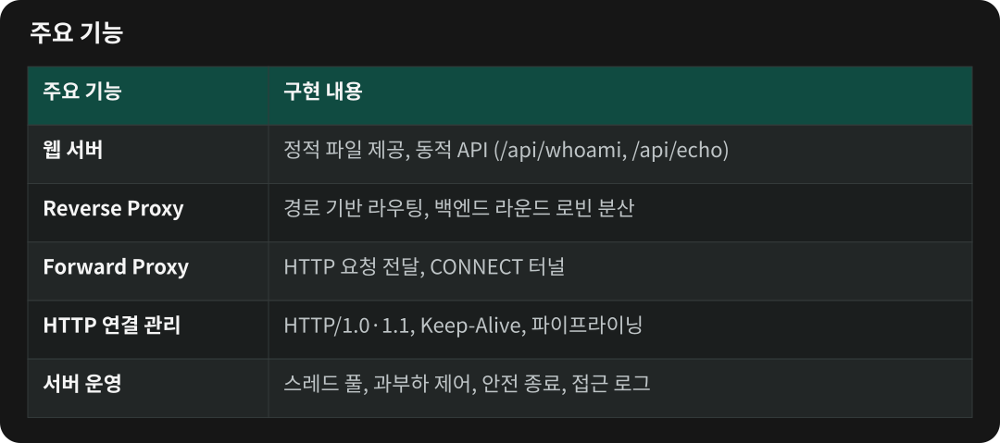

**발표 흐름** · [요청 처리 구조](#2-요청-처리-구조) → [핵심 구현](#3-핵심-구현) → [동시성 설계](#4-동시성-설계) → [성능 측정](#5-성능-측정) → [검증 및 한계](#6-검증-및-한계)

**참고 자료** · [기술 Q&A](#7-기술-qa) · [실행 방법 및 기술 문서](#8-실행-방법-및-기술-문서)

---

## 2. 요청 처리 구조

**메인 스레드는 연결 수락을, 작업자 스레드는 HTTP 요청 처리를 담당합니다.**

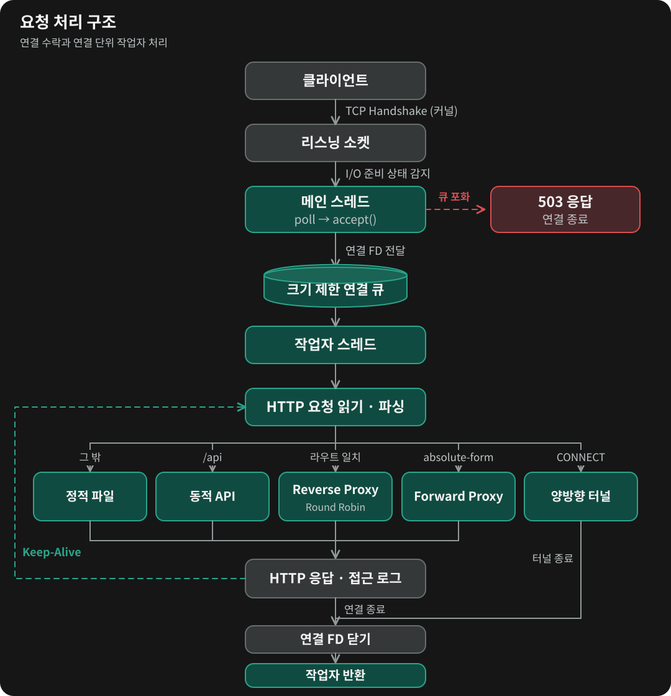


---

## 3. 핵심 구현

### 3-1. HTTP 요청 경계와 연결 재사용

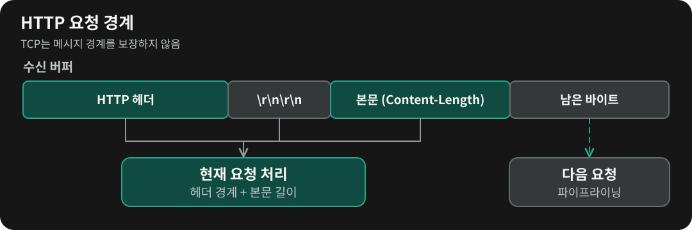

HTTP 요청은 헤더의 빈 줄과 `Content-Length`를 기준으로 구분하고, 남은 데이터를 다음 요청에 활용하여 파이프라이닝을 지원했습니다.


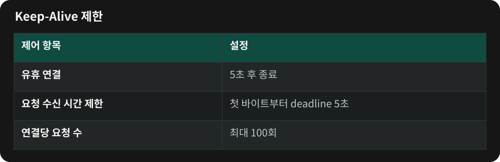

Keep-Alive로 TCP 연결을 재사용하되, 연결이 서버 자원을 무기한 점유하지 않도록 시간과 요청 횟수를 제한했습니다.

### 3-2. Proxy와 요청 분산

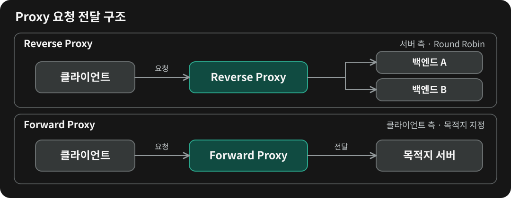

**Reverse Proxy**는 경로 기반 라우팅과 Round Robin을 통해 백엔드 서버에 요청을 분산합니다.
**Forward Proxy**는 클라이언트가 지정한 목적지로 요청을 전달합니다.


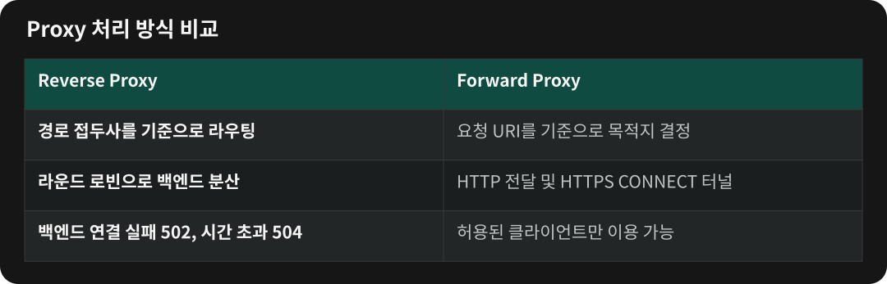

HTTPS 요청은 CONNECT 터널을 통해 TLS 데이터를 복호화하지 않고 양방향으로 중계합니다.


<details>
<summary><b>핵심 코드 위치 및 추가 구현</b></summary>

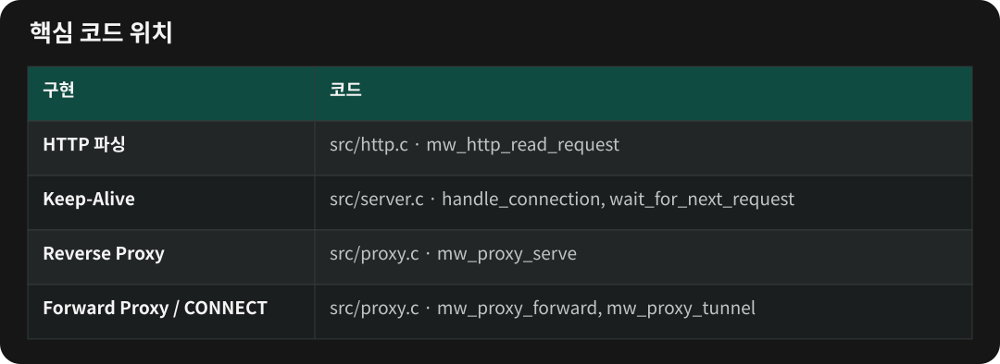

- **네트워크:** non-blocking 소켓과 `poll()`로 I/O deadline 제어
- **메모리:** 연결별 수신 버퍼, 정적 파일 8 KiB 단위 전송, 프록시 응답 크기 제한
- **안전 종료:** self-pipe로 종료 신호를 메인 루프에 전달하고 작업자 정리

</details>

---

## 4. 동시성 설계

### 4-1. 왜 스레드 풀을 선택했는가?

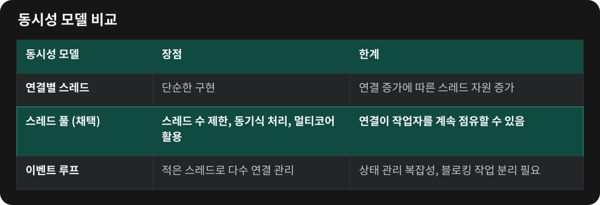

Process-per-Request 방식은 요청마다 프로세스를 생성하는 비용이 발생합니다.

Event Loop 방식은 하나의 흐름이 모든 연결을 처리하므로, DNS 조회(`getaddrinfo`)나 파일 읽기 같은 블로킹 작업 하나가 전체 연결을 멈출 수 있습니다.

따라서 **블로킹 작업이 서로를 막지 않도록** 작업자 스레드를 고정된 수만큼 두는 Thread Pool 방식을 채택했습니다. 작업자는 OS 스레드이므로 커널이 여러 코어에 나누어 실행할 수 있습니다.

### 4-2. 과부하 제어와 구조적 한계

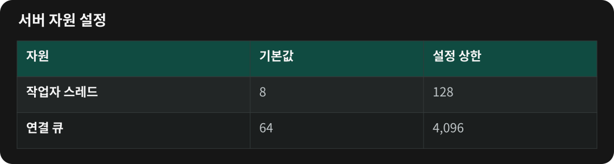

작업자 수와 연결 큐의 크기에 상한을 두고, 큐 포화 시 **503 Service Unavailable**을 반환하여 과부하를 제어합니다


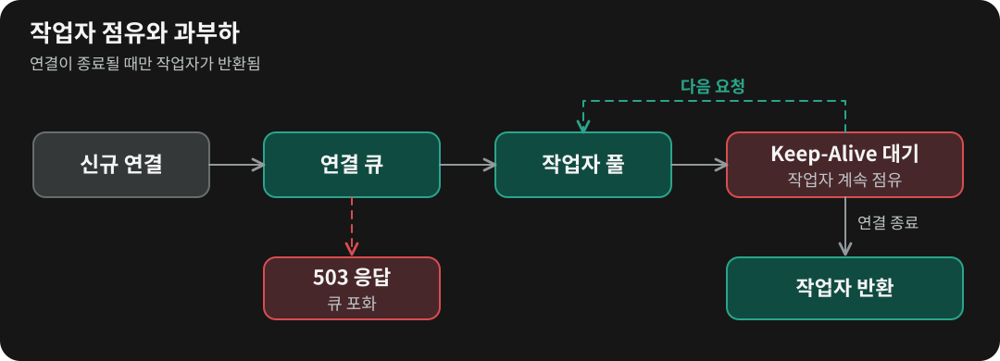

다만 연결 단위로 작업자를 할당하기 때문에, 요청 처리가 끝나더라도 연결이 유지되면 작업자는 반환되지 않습니다.

따라서 Keep-Alive 연결이나 느린 클라이언트가 증가하면 **신규 연결을 처리할 작업자가 부족해지는 구조적 한계**가 존재합니다.

---

## 5. 성능 측정

### 5-1. 측정 목적

구현한 웹 서버의 성능 특성을 확인하기 위해 작업자 수, 동시 연결 수, Keep-Alive 여부에 따른 처리량, 응답 지연, 요청 실패 건수를 측정했습니다.

- **측정 환경**: WSL2 Ubuntu · Ryzen 5 7535HS · 논리 CPU 12개
- **측정 조건:** 1 KiB 응답 · 조합별 1,000요청 · 1회 측정
- **비교 대상:** 작업자 8개 / 64개, 동시 접속 50개 / 100개
- **측정 지표:** Throughput · p95 Latency · Failed Requests

### 5-2. 측정 결과 — 정적 파일

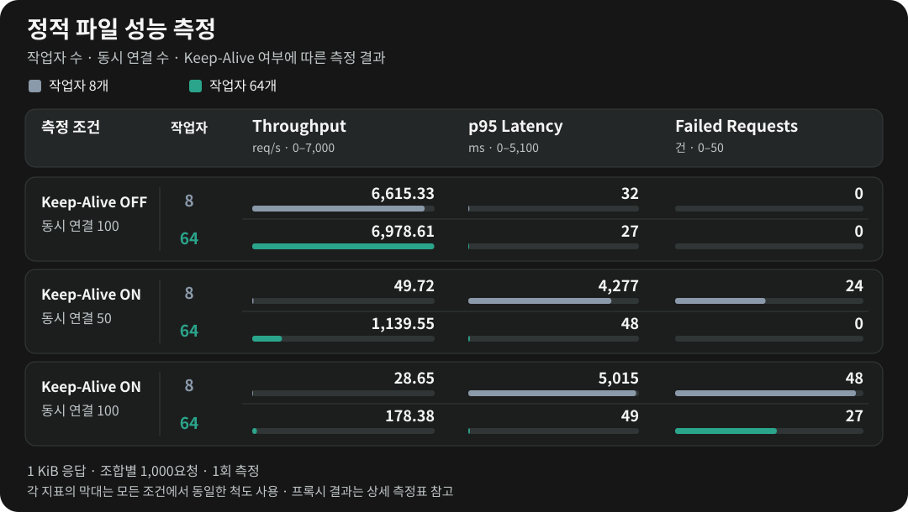

<sub>[원본 측정 표](docs/diagrams/source/11-benchmark.md)</sub>

Keep-Alive를 사용하지 않는 환경에서는 동시 연결 100개 기준 약 6,600~7,000 req/s의 처리량을 기록했습니다.

반면 Keep-Alive를 사용하고 동시 연결 수가 작업자 수를 초과한 환경에서는 **처리량 감소와 요청 실패가 발생했습니다.**


<details>
<summary><b>전체 README 측정값 — 프록시 포함, p95 및 실패 건수</b></summary>

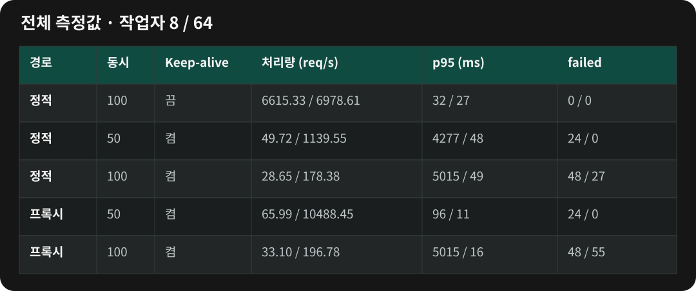

</details>

측정은 1회 실행한 결과이며, 1만 연결이나 실제 운영 환경에서의 최대 처리 용량을 검증한 것은 아닙니다. 전체 32개 조합은 [`docs/bench.md`](docs/bench.md)를 참고합니다.

---

## 6. 검증 및 한계

### 6-1. 테스트

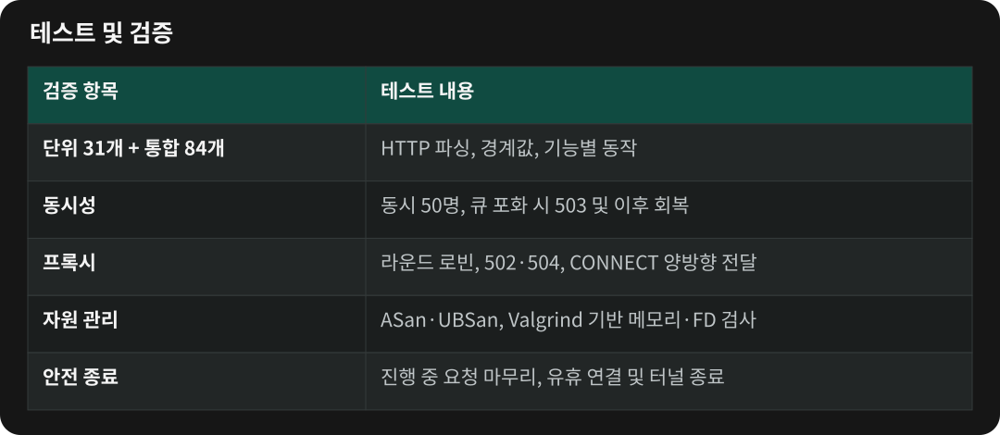

AI가 구현한 코드의 정상 동작뿐만 아니라 **실제 웹 서버에서 발생할 수 있는 예외 상황까지 검증했습니다.**

### 6-2. 한계 및 개선 방향

작업자 증설로 일부 성능을 개선할 수 있지만, **연결과 작업자가 일대일로 묶이는 구조적 한계**는 여전히 존재합니다.

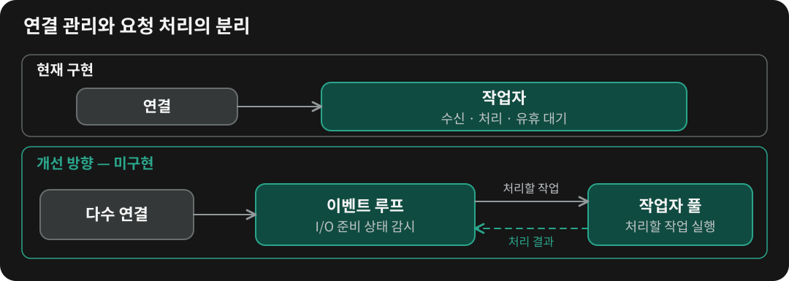


개선 후보로 Event Loop와 Thread Pool을 결합한 혼합형 모델을 고려했습니다. 다만 이 방식 역시 연결별 상태 관리와 블로킹 작업 분리에 따른 구현 복잡도가 증가합니다.

**결국 핵심**은 특정 동시성 모델을 채택하는 것이 아니라, 연결 관리와 요청 처리를 분리하여 불필요한 작업자 점유를 줄이는 것입니다.

> 혼합형 모델, C10K 대응 및 비동기 DNS는 현재 구현 범위에 포함되지 않습니다.

---

## 7. 기술 Q&A

발표 중에는 생략하고, 질의응답에서 해당 질문만 펼쳐 확인합니다. 답변은 현재 구현체의 설계 이유, 동작 원리, 트레이드오프를 중심으로 정리했습니다.

[네트워크](#7-1-네트워크) · [HTTP](#7-2-http) · [동시성](#7-3-동시성) · [Proxy](#7-4-proxy) · [자원 관리](#7-5-자원-관리) · [안전 종료](#7-6-안전-종료)

### 7-1. 네트워크

<details>
<summary><b>Q1. TCP Handshake는 왜 애플리케이션에서 구현하지 않았는가?</b></summary>

**답변:** TCP 연결 수립은 OS 커널이 담당합니다. 메인 스레드는 리스닝 소켓의 준비 상태를 `poll()`로 확인한 뒤 `accept()`로 연결 FD를 획득합니다.

**근거:** `src/net.c` · `src/server.c`의 `accept_loop`

</details>

<details>
<summary><b>Q2. Non-blocking 소켓과 `poll()`을 함께 사용한 이유는?</b></summary>

**답변:** Non-blocking 소켓으로 I/O 호출의 무기한 대기를 방지하고, `poll()`로 준비 상태를 확인하면서 정해진 deadline까지만 기다리도록 했습니다. 리스닝 소켓은 self-pipe와 함께 감시하여 종료 신호에도 대응합니다.

**근거:** `src/net.c` · `src/server.c`

</details>

### 7-2. HTTP

<details>
<summary><b>Q3. TCP에서 HTTP 요청의 경계를 어떻게 구분하는가?</b></summary>

**답변:** TCP는 바이트 스트림이므로 한 번의 수신과 HTTP 요청 하나가 일치하지 않습니다. 헤더는 `\r\n\r\n`, 본문은 `Content-Length`를 기준으로 구분하고, 남은 바이트는 다음 요청에 활용합니다. 파싱 오류가 발생하면 연결을 닫습니다.

**근거:** `src/http.c` · `mw_http_read_request`

</details>

<details>
<summary><b>Q4. Keep-Alive 연결이 서버 자원을 계속 점유하지 않는가?</b></summary>

**답변:** 점유할 수 있습니다. 유휴 시간 5초, 요청 수신 deadline 5초, 연결당 최대 100회 요청을 제한하여 무기한 점유를 방지했습니다. 다만 유휴 시간 동안에도 작업자가 연결을 담당한다는 한계는 남습니다.

**근거:** `src/server.c` · `handle_connection` · `wait_for_next_request`

</details>

### 7-3. 동시성

<details>
<summary><b>Q5. 왜 Event Loop 대신 Thread Pool을 선택했는가?</b></summary>

**답변:** 서버에 DNS 조회(`getaddrinfo`)와 파일 읽기 같은 블로킹 작업이 있어, 이벤트 루프에서는 작업 하나가 전체 연결을 멈출 수 있습니다. 스레드 풀은 블로킹을 작업자 하나에 가두고, 작업자가 OS 스레드라 여러 코어에서 실행될 수 있습니다. 또한 명세가 C10K를 목표로 하지 않고, WSL2 · macOS 이식성을 위해 `epoll` · `kqueue`를 쓰지 않아 이벤트 루프의 이점도 제한적이었습니다.

**근거:** [4. 동시성 설계](#4-동시성-설계) · `src/pool.c`

</details>

<details>
<summary><b>Q6. Non-blocking인데 왜 작업자가 점유되는가?</b></summary>

**답변:** Non-blocking은 개별 소켓 I/O 호출의 동작 방식이지 작업자 반환을 보장하는 동시성 모델이 아닙니다. 현재 작업자는 연결 단위로 할당되며 `poll()`로 다음 요청을 기다리므로, 연결이 종료되기 전에는 다른 연결을 담당할 수 없습니다.

**근거:** `src/server.c` · `handle_connection` · `wait_for_next_request`

</details>

<details>
<summary><b>Q7. 왜 연결 큐에 크기 제한을 두었는가?</b></summary>

**답변:** 신규 연결이 처리 속도보다 빠르게 유입될 때 대기 FD와 자원 사용량이 무한히 늘어나는 것을 방지하기 위해서입니다. 큐가 포화되면 503을 반환하고 연결을 닫습니다. 큐 접근에만 mutex를 사용하며 I/O 중에는 큐 잠금을 유지하지 않습니다.

**근거:** `src/pool.c` · `src/server.c`의 `reject_overloaded`

</details>

<details>
<summary><b>Q8. 작업자 수를 계속 늘리면 병목을 해결할 수 있지 않은가?</b></summary>

**답변:** 작업자를 늘리면 일부 처리량은 개선됩니다. 실제 동시 접속 100, Keep-Alive ON 정적 파일 실험에서 8개 작업자의 28.65 req/s가 64개 작업자의 178.38 req/s로 개선됐지만 실패는 48건에서 27건으로 줄었을 뿐 사라지지 않았습니다. 연결이 작업자를 점유하는 구조는 그대로입니다.

**근거:** [5. 성능 측정](#5-성능-측정) · [`docs/bench.md`](docs/bench.md)

</details>

<details>
<summary><b>Q9. C10K 대응을 검증했는가? 향후 어떻게 개선할 것인가?</b></summary>

**답변:** 이번 벤치마크는 조합별 1,000요청, 1회 측정이며 1만 동시 연결을 검증하지 않았습니다. 현재 한계를 개선하기 위해 이벤트 루프가 연결을 관리하고 실제 처리할 작업을 스레드 풀에 위임하는 혼합형 모델을 후보로 두었습니다. 아직 구현하지 않았습니다.

**근거:** [6. 검증 및 한계](#6-검증-및-한계)

</details>

### 7-4. Proxy

<details>
<summary><b>Q10. Forward Proxy와 Reverse Proxy의 차이는 무엇인가?</b></summary>

**답변:** Forward Proxy는 클라이언트가 지정한 목적지로 요청을 중계합니다. Reverse Proxy는 서버 측의 경로 접두사에 따라 백엔드를 선택하고 Round Robin으로 분산합니다. 현재 Forward Proxy는 `--forward-allow`로 허용된 클라이언트만 사용할 수 있습니다.

**근거:** `src/proxy.c` · `mw_proxy_serve` · `mw_proxy_forward`

</details>

<details>
<summary><b>Q11. HTTPS를 복호화하지 않고 어떻게 전달하는가?</b></summary>

**답변:** CONNECT 요청으로 목적지 서버와 연결을 맺은 뒤 두 소켓의 I/O를 `poll()`로 감시하여 양방향 데이터를 중계합니다. TLS는 클라이언트와 목적지 서버 사이에서 처리되며 프록시가 직접 복호화하지 않습니다. 터널이 유지되는 동안 작업자 하나가 점유됩니다.

**근거:** `src/proxy.c` · `mw_proxy_tunnel`

</details>

### 7-5. 자원 관리

<details>
<summary><b>Q12. 큰 정적 파일은 어떻게 전송하고 메모리는 어떻게 관리하는가?</b></summary>

**답변:** 정적 파일 전체를 메모리에 적재하지 않고 8 KiB 단위로 읽어 전송합니다. 수신 버퍼는 연결별로 유지하고, 프록시 응답 버퍼는 요청마다 해제합니다. FD 소유권과 회수 규칙은 모듈 계약에 명시합니다.

**근거:** `src/static.c` · [`docs/CONTRACT.md`](docs/CONTRACT.md)

</details>

### 7-6. 안전 종료

<details>
<summary><b>Q13. 서버 종료 시 처리 중인 요청과 연결은 어떻게 되는가?</b></summary>

**답변:** 시그널 핸들러는 플래그와 self-pipe의 1바이트 쓰기로 메인 루프를 깨웁니다. 리스너와 큐의 대기 연결을 닫고, 처리 중인 요청은 마무리하며 유휴 연결과 터널은 종료합니다. 작업자 스레드를 join한 뒤 메모리를 해제합니다.

**근거:** `src/server.c` · `on_stop_signal` · `mw_server_run` · `src/pool.c`

</details>

---

## 8. 실행 방법 및 기술 문서

발표 이후 재현과 코드 리뷰에 필요한 부록입니다. 상세 구현 원리, 실행 명령, 제약 사항 및 테스트 시나리오를 포함합니다.

<details>
<summary><b>빠른 시작 — 빌드 · 실행 · 프록시 시연 · 옵션</b></summary>

#### ① 준비 · 빌드 · 테스트

Windows 는 PowerShell(관리자)에서 `wsl --install -d Ubuntu-24.04` 한 번. 그다음 Ubuntu 에서:

```sh
sudo apt-get update && sudo apt-get install -y build-essential python3 curl clang-format-18
git clone https://github.com/kuk-hwan/WEEK13-Kkilkkilson.git && cd WEEK13-Kkilkkilson
git config core.hooksPath .githooks
make && make test
```

#### ② 실행 — 서버 하나, 또는 프록시 + 백엔드 A · B

```sh
# 서버 하나
./build/mini-webserver --port 8080

# 프록시 + A · B (터미널 3개)
./build/mini-webserver --port 9001 --name A
./build/mini-webserver --port 9002 --name B
./build/mini-webserver --port 9000 --route '/api=127.0.0.1:9001,127.0.0.1:9002'

curl http://127.0.0.1:9000/api/whoami   # A, 한 번 더 하면 B
```

- 브라우저 `http://127.0.0.1:9000/` → 데모 페이지. 끄기는 Ctrl-C (종료 코드 0)
- 이 구성 전체를 curl 로 한 번에 : `make smoke`

<details>
<summary><b>curl 예시 · 접근 로그 · macOS · 선택 도구</b> (펼치기)</summary>

```sh
curl -i http://127.0.0.1:8080/                          # 200 데모 페이지
curl -i http://127.0.0.1:8080/api/whoami                # {"name":"server-8080","port":8080}
curl -i --data 'hello' http://127.0.0.1:8080/api/echo   # 본문 그대로
curl -i http://127.0.0.1:8080/missing.html              # 404
```

요청마다 표준 오류에 한 줄 : 시각 · 클라이언트 · 메서드 · 경로 · 상태 · 보낸 바이트 · 처리 시간

```text
2026-11-25T02:13:09Z 127.0.0.1 GET /api/whoami 200 163 0ms
```

- macOS : Xcode Command Line Tools, Python 3, clang-format
- 선택 : `apache2-utils`(부하 측정), `valgrind`(메모리 검사)

</details>

<details>
<summary><b>포워드 프록시로 쓰기</b> (펼치기)</summary>

```sh
./build/mini-webserver --port 8080 --forward-allow 127.0.0.1/32
curl -x http://127.0.0.1:8080 http://127.0.0.1:9001/api/whoami      # 전달
curl -x http://127.0.0.1:8080 https://example.com/                   # CONNECT 터널
curl -p -x http://127.0.0.1:8080 http://127.0.0.1:9001/api/whoami   # TLS 없이 CONNECT
```

- `--forward-allow` 가 하나라도 있어야 켜진다. 목록 밖은 **403**
- `https://` 는 CONNECT 터널. 바이트를 해석하지 않고 양쪽으로 넘긴다
- 터널 하나 = 작업자 하나. 브라우저 프록시로 쓰면 `--workers 64` 처럼 늘린다
- 목적지 DNS(`getaddrinfo`)는 블로킹. 3초 deadline 밖이다

</details>

<details>
<summary><b>옵션과 종료 코드</b> (펼치기)</summary>

| 인자 | 기본값 | 범위 |
|---|---|---|
| `--host` | `127.0.0.1` | IPv4 |
| `--port` | `8080` | 1~65535 |
| `--root` | `public` | 있는 디렉터리 |
| `--workers` | `8` | 1~128 |
| `--queue` | `64` | 1~4096 |
| `--name` | `server-<포트>` | 63바이트 |
| `--route` | 없음 | `'/접두사=호스트:포트[,...]'` 16개 × 백엔드 8개 |
| `--forward-allow` | 없음 (꺼짐) | CIDR 16개 |

| 종료 코드 | 뜻 |
|---|---|
| 0 | 정상 종료 |
| 1 | 실행 오류 (포트 충돌 등) |
| 2 | 인자 오류 |

</details>

</details>

<details>
<summary><b>모듈 구성 및 FD 소유권</b></summary>

| 모듈 | 파일 | 하는 일 |
|---|---|---|
| main | `src/main.c` | 인자 → 실행 → 종료 코드 |
| config | `src/config.c` | 옵션 검증, 루트 FD, 라우트 |
| net | `src/net.c` | listen · connect, deadline 읽기 · 쓰기 |
| pool | `src/pool.c` | 작업자 N개 + 크기 제한 큐 |
| http | `src/http.c` | 요청 파싱 · 한도, 응답 헤더 |
| app | `src/server.c` | accept 루프, keep-alive, 분기, 로그, 종료 |
| static | `src/static.c` | 경로 검사, 8 KiB씩 전송 |
| proxy | `src/proxy.c` | 라우트, 라운드 로빈, 포워드, 터널 |

<details>
<summary><b>FD 수명</b> (펼치기)</summary>

| FD | 용도 | 언제 닫나 |
|---|---|---|
| 루트 디렉터리 | 파일 열기 기준 | 서버 끝날 때 |
| 리스너 | 새 연결 받기 | accept 루프 끝 |
| self-pipe | 시그널로 루프 깨우기 | 서버 끝날 때 |
| 클라이언트 | 요청 · 응답 | 연결 처리가 끝나면 |
| 백엔드 · 목적지 | 프록시 · 터널 | 요청(터널) 하나 끝나면 |
| 정적 파일 | 파일 읽기 | 전송 뒤 |

</details>

</details>

<details>
<summary><b>세부 구현 원리 및 코드 위치</b></summary>

> 항목마다 같은 순서 : **한 줄 답 → 어떻게 → 코드 → 확인**

#### 8-1. handshake · `SO_REUSEADDR` · blocking

> handshake 는 **커널**이, non-blocking 은 **시간 제한**을 위해.

- **handshake**
	- SYN → SYN-ACK → ACK 는 커널이 끝낸다
	- `accept`는 연결 수립을 마친 소켓을 커널의 완료된 연결 대기열에서 꺼낸다 (`listen`의 backlog는 `SOMAXCONN`으로 요청)
- **`SO_REUSEADDR`**
	- 종료 직후 기존 TCP 연결이 TIME_WAIT 상태로 남을 수 있다
	- 이 옵션으로 바로 재시작 → `socket → SO_REUSEADDR → bind → listen`
- **blocking / non-blocking**
	- 리스너 : non-blocking + self-pipe 와 함께 `poll` (종료 신호에 바로 깸)
	- 연결 소켓 : non-blocking + `poll` 로 **절대 deadline** 까지 기다림
	- 작업자에게는 동기식 코드. 하지만 느린 상대 때문에 영원히 멈추지 않는다
	- 백엔드 연결 : non-blocking `connect`(`EINPROGRESS`), 3초

코드 `src/net.c`, `src/server.c` `accept_loop`
확인 같은 포트 즉시 재시작 · 포트 충돌 종료 코드 1 · deadline 단위 테스트

#### 8-2. 요청 경계와 `Content-Length`

> TCP 는 경계가 없다 → **빈 줄**과 **`Content-Length`** 로 자른다.

- 요청이 쪼개져 오거나, 두 개가 붙어 올 수 있다
- 머리 = 빈 줄(`\r\n\r\n`)까지
- 본문 = `Content-Length` 바이트만큼
- 남은 바이트 = 다음 요청 (파이프라이닝)

| 경우 | 응답 |
|---|---|
| 숫자 아님 · 다른 값 중복 | 400 |
| POST 에 없음 | 411 |
| 1 MiB 초과 | 413 (본문 읽기 전) |
| chunked 요청 본문 | 501 |

- 파싱 오류 뒤에는 경계를 못 믿으니 **연결을 닫는다**

코드 `src/http.c` `mw_http_read_request`
확인 나뉘어 온 머리 · 한 바이트씩 · 파이프라이닝 · 400 · 411 · 413 · 501

#### 8-3. keep-alive

> 연결을 다시 쓰되, **시간 · 횟수 상한**을 둔다.

| 항목 | 값 | 넘으면 |
|---|---|---|
| 유지 조건 | 1.1 기본 · 1.0 은 요청할 때만 | `Connection: close` |
| 유휴 | 5초 | 조용히 닫기 |
| 요청 deadline | 첫 바이트부터 5초 (안 늘어남) | 408 후 닫기 |
| 연결당 요청 | 100 | 100번째에 close |
| 서버 종료 중 | — | 유휴 연결 바로 닫기 |

코드 `src/server.c` `handle_connection` · `wait_for_next_request`
확인 1.1 · 1.0 · 파이프라이닝 · 100번째 · 느린 머리 · 유휴 종료 · 종료 중 닫기

#### 8-4. 동시성 트레이드오프와 C10K

> **스레드 풀 + 크기 제한 큐**. 대가는 쉬는 연결도 작업자를 붙잡는 것.

**우리 모델**
- 메인 스레드 : `accept` → 연결 FD 를 큐에
- 작업자 N개 : FD 를 꺼내 **연결이 끝날 때까지** 맡음
- 큐가 가득 → 503
- mutex 는 큐만. I/O 중엔 잠금 없음

**세 모델 비교**

| 모델 | 얻는 것 | 내주는 것 |
|---|---|---|
| 연결마다 스레드 | 가장 단순 | 연결 수에 비례해 스레드가 늘어남 |
| **스레드 풀 (선택)** | 스레드 상한, 동기식 코드, 여러 코어 | 쉬는 연결 · 터널이 작업자를 잡음 |
| 이벤트 루프 | 스레드 하나로 연결 수천 | 상태 기계 필요, 블로킹 하나가 전체를 멈춤 |

**이벤트 루프를 안 고른 이유**
1. 블로킹 작업이 있다 — DNS(`getaddrinfo`), 디스크 파일(`poll` 불가)
2. 명세가 C10K 를 목표로 하지 않는다
3. WSL2 · macOS 모두 지원하기 위해 OS별 `epoll` · `kqueue` 구현을 이번 범위에서 제외했다
4. 동기식 코드가 리뷰 · 테스트로 검증하기 쉽다

**C10K — 1만 연결에서 예상되는 자원 제약**

| 순서 | 자원 | 한도 | 넘으면 |
|---|---|---|---|
| 1 | 작업자 | 최대 128 | 큐에서 대기 |
| 2 | 연결 큐 | 최대 4096 | 503 |
| 3 | `listen` 대기열 | `SOMAXCONN` | 커널이 늦추거나 버림 |
| 4 | FD 수 | `ulimit -n` | `EMFILE` → 10 ms 쉬고 재시도 |
| 5 | 스레드 메모리 | 스택 8 MiB (가상, 환경에 따라 다름) | 스레드 자원 부담 증가 |

- 결론: 연결이 작업자를 점유하는 구조가 주요 병목으로 관찰되었다. 실제 1만 연결에서 어떤 자원이 먼저 고갈되는지는 별도 측정이 필요하다.
- 다음 단계 (구현 안 함): 쉬는 연결을 작업자에게서 분리 → 이벤트 기반 연결 관리 → 상태 기계 파서 및 블로킹 작업 분리
- 측정으로 본 대가 → [5. 성능 측정](#5-성능-측정)

코드 `src/pool.c`, `src/server.c` `accept_loop` · `reject_overloaded`
확인 동시 50명 모두 200 · 큐 초과 503 · `make bench`

#### 8-5. Proxy 와 Reverse Proxy

> Reverse 는 **서버 편**, Forward 는 **클라이언트 편**.

| | Reverse | Forward |
|---|---|---|
| 누구 편 | 서버 (백엔드를 숨김) | 클라이언트 (목적지를 고름) |
| 요청 대상 | `GET /api/whoami` | `GET http://host/path`, `CONNECT host:port` |
| 목적지 | 가장 긴 접두사 + 라운드 로빈 | 요청 URI |
| 켜기 | `--route` | `--forward-allow` |
| 함수 | `mw_proxy_serve` | `mw_proxy_forward` · `mw_proxy_tunnel` |

- 공통 : hop-by-hop 헤더 제거, `X-Forwarded-For` 덮어쓰기
- 백엔드 응답 : 8 MiB 까지, chunked 는 풀어서
- 실패 : 연결 실패 · 깨진 응답 502, 3초 초과 504, **재시도 없음**
- CONNECT : TLS 를 풀지 않고 두 소켓을 `poll` 하며 바이트만 넘김
- 허용 목록이 없으면 안 켜짐 → "열린 프록시" 불가 ([ADR-0001](docs/adr/0001-forward-proxy.md))

확인 라우트 · 라운드 로빈 단위 테스트, 프록시 · 라우팅 · 포워드 · 터널 통합 테스트, `make smoke`

#### 8-6. 메모리 관리

> 연결마다 버퍼 **하나**, 파일은 **조각으로**, 모든 경로에서 **회수**.

- 읽기 버퍼 : 연결마다 하나, 16 KiB 로 시작 → 필요하면 1 MiB 까지
- 파일 : 통째로 안 올림, 8 KiB 씩
- 프록시 버퍼 : 요청마다 해제, 8 MiB 넘으면 502
- `malloc` · `free` 는 같은 모듈 안에서 짝
- FD 를 누가 닫는지 : [`docs/CONTRACT.md`](docs/CONTRACT.md)

확인 `make sanitize-test` (ASan · UBSan) · `make valgrind` (힙 · 오류 · 남은 FD)

#### 8-7. 시그널과 종료

> 핸들러는 **플래그 + 1바이트**만. 나머지는 메인 루프가.

- 핸들러 : 플래그 세우고 self-pipe 에 1바이트 (async-signal-safe)
- 작업자 : SIGINT · SIGTERM 을 막음 → 메인만 받음
- `SIGPIPE` : 무시, 쓰기 실패는 반환값으로

**종료 순서**
1. 리스너 닫기
2. 큐의 대기 연결 닫기
3. 처리 중 요청은 마무리, 유휴 연결 · 터널은 바로 닫기
4. 작업자 join
5. 메모리 해제 → 종료 코드 0

코드 `src/server.c` `on_stop_signal` · `mw_server_run`, `src/pool.c`
확인 종료 통합 테스트 · `make valgrind` 의 SIGINT 종료 검사

</details>

<details>
<summary><b>HTTP 지원 범위 및 제약 사항</b></summary>

| 항목 | 한도 | 넘으면 |
|---|---|---|
| 메서드 | GET · HEAD · POST (+ 포워드 켜면 CONNECT) | 501 |
| 버전 | 1.0 · 1.1 | 505 |
| 요청 줄 | 8 KiB | 414 |
| 머리 | 16 KiB, 64개 | 431 |
| 본문 | 1 MiB | 413 |
| `Host` | 1.1 에서 필수 | 400 |
| `Expect` | `100-continue` 만 | 417 |
| 요청 시간 | 5초 | 408 |
| 백엔드 시간 | 3초 | 504 |
| 유휴 · 터널 유휴 | 5초 | 닫기 |

- 오류 응답(400 · 408 · 411 · 413 · 414 · 417 · 431 · 501 · 505) 뒤에는 연결을 닫는다
- 자세히 : [`docs/spec.md`](docs/spec.md) · [`docs/CONTRACT.md`](docs/CONTRACT.md)

**범위 밖**
- TLS 종료 (HTTPS 는 터널로 넘기기만)
- chunked 요청 본문
- HTTP/2 · 압축 · 캐시 · IPv6
- 백엔드 헬스 체크 · 재시도 · 연결 재사용
- 동시 터널 수 제한 · 반쪽 닫기
- OS 별 `epoll` · `kqueue`

</details>

<details>
<summary><b>테스트 명령 및 상세 시나리오</b></summary>

> AI 가 짠 코드를 **웹서버가 실제로 겪는 상황**으로 검증한다.

| 명령 | 확인 | CI |
|---|---|---|
| `make test` | 단위 31 + 통합 84 | ubuntu · macOS |
| `make smoke` | 프록시 + A · B, 포워드, CONNECT | ubuntu · macOS |
| `make sanitize-test` | ASan · UBSan | ubuntu |
| `make valgrind` | 힙 · 메모리 오류 · FD | valgrind |
| `make CLANG_FORMAT=clang-format-18 format-check` | 포맷 | ubuntu |
| `make bench` | 처리량 · 지연 | 수동 |

**통합 테스트 11묶음**

| 묶음 | 실제 상황 |
|---|---|
| 첫 응답 | 나뉘어 온 머리, 포트 충돌, 즉시 재시작, 끊긴 클라이언트 |
| 동시성 | 동시 50명, 큐 초과 503 뒤 회복, 느린 클라이언트 |
| HTTP 파싱 | 오류 뒤 닫기, 413, `Expect`, HEAD |
| 정적 파일 | 인코딩된 이름, 경로 탈출, 권한 403, 큰 이진 파일 |
| 동적 | whoami, echo 바이트 일치, 405 |
| keep-alive | 1.1 · 1.0, 파이프라이닝, 100번째, 유휴, 접근 로그 |
| 프록시 | 재작성, 502 · 504, 재시도 없음, 8 MiB |
| 라우팅 | A · B 번갈아, 긴 접두사, 동시 100 고르게 |
| 포워드 | origin-form 전달, 403, 꺼지면 400 |
| 터널 | 양방향, 5초 유휴, SIGINT |
| 종료 | 0 으로 종료, 응답 마무리, 큰 응답 중 끊김 |

<details>
<summary><b>그 밖의 명령</b> (펼치기)</summary>

```sh
make format                               # 포맷 적용
make test TEST_ARGS=--self-test-failure   # 의도적 실패 (0 이 아니면 정상)
make clean
```

</details>

</details>

### 관련 문서

| 문서 | 내용 |
|---|---|
| [`docs/spec.md`](docs/spec.md) | 명세 |
| [`docs/CONTRACT.md`](docs/CONTRACT.md) | 모듈 계약 · 소유권 · 한도 |
| [`docs/adr/0001-forward-proxy.md`](docs/adr/0001-forward-proxy.md) | 포워드 프록시 결정 |
| [`docs/bench.md`](docs/bench.md) | 측정 방법 · 결과 |
| [`GLOSSARY.md`](GLOSSARY.md) | 용어집 |
| [`docs/NEXT.md`](docs/NEXT.md) | 담당 · 다음 할 일 |

- PR 은 `dev` 로 → CI(`ci-ubuntu` · `ci-valgrind` · `ci-macos` · `pr-title`) 초록 + 리뷰 → 머지
- 작업 현황 : [Week 13 Project](https://github.com/users/kuk-hwan/projects/12)
